# Visual Architecture Guide — Time to Power / GridForge Engine

All 15 production visuals are located under `public/images/visuals/` (PNG + WebP 1600×900) and `public/images/og/` (1200×630 social cards). Extract the repository-root zip with `unzip -o gridforge-repo-root-visuals.zip -d .` so paths resolve cleanly.

Design system: `#060911` canvas, slate chassis `#0D1424`–`#131C31`, electric cyan `#00E5FF`, amber `#F59E0B`, crimson `#EF4444`, emerald `#10B981`. True 30° orthographic isometric for spatial scenes; flat dark CAD for analytical. Evidence Class E0–E7 on every quantitative claim. Calibration ledger: 0 rows (pilot).

## Integration Snippets

```jsx
import Image from 'next/image';

<picture>
  <source srcSet="/images/visuals/hero-binding-constraint-ai-hall.webp" type="image/webp" />
  <Image
    src="/images/visuals/hero-binding-constraint-ai-hall.png"
    alt="Isometric cutaway of brownfield AI data hall showing 2500 kVA transformer and chiller at partial load while 63 A tap-offs bind racks and strand floor positions."
    width={1600}
    height={900}
    priority
  />
</picture>
```

## Diagram Catalogue

### 01. hero-binding-constraint-ai-hall
- **Routes**: `/` Hero, `README.md` banner
- **Alt**: Isometric cutaway of brownfield AI data hall showing 2500 kVA transformer and chiller at partial load while 63 A tap-offs bind racks and strand floor positions.
- **Preview**: 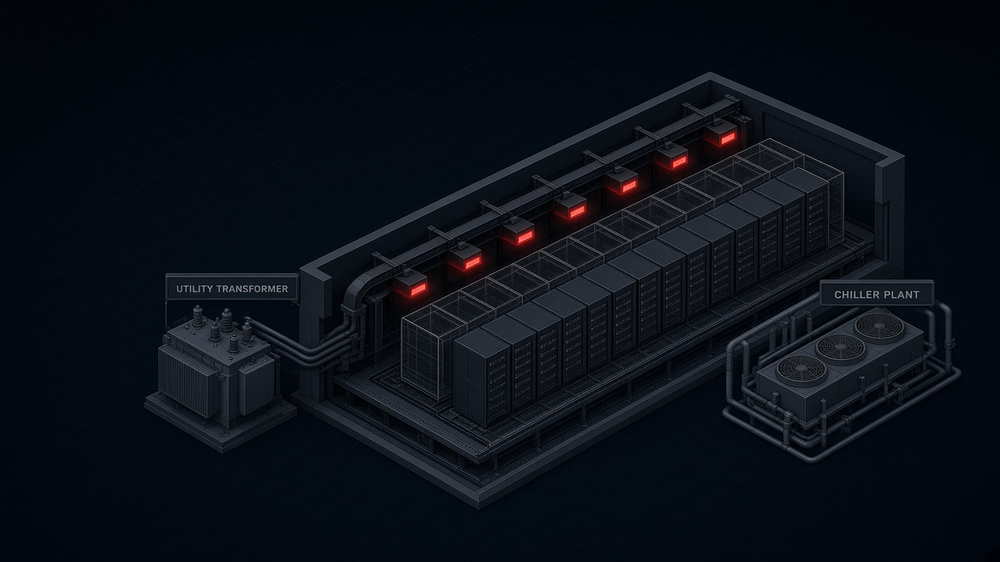

### 02. thirteen-constraints-matrix-map
- **Routes**: `/methodology`, `#constraints`
- **Alt**: Dark CAD blueprint of 13 deterministic constraints in three columns: 5 electrical, 6 thermal, 2 physical, converging to min deployable racks solver.
- **Preview**: 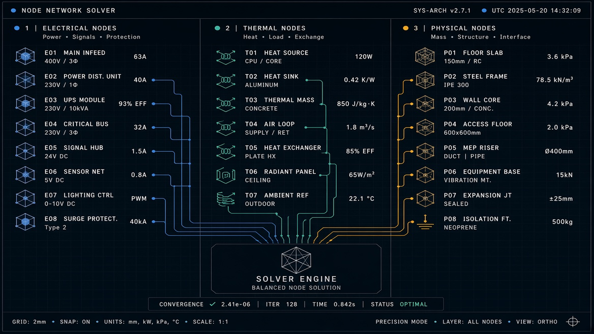

### 03. headroom-ladder-capex-relief-steps
- **Routes**: `/product`, `#headroom-ladder`
- **Alt**: Stepped capacity staircase from 12 racks baseline bound by 63 A tap-off through successive CapEx relief rungs to transformer hard ceiling.
- **Preview**: 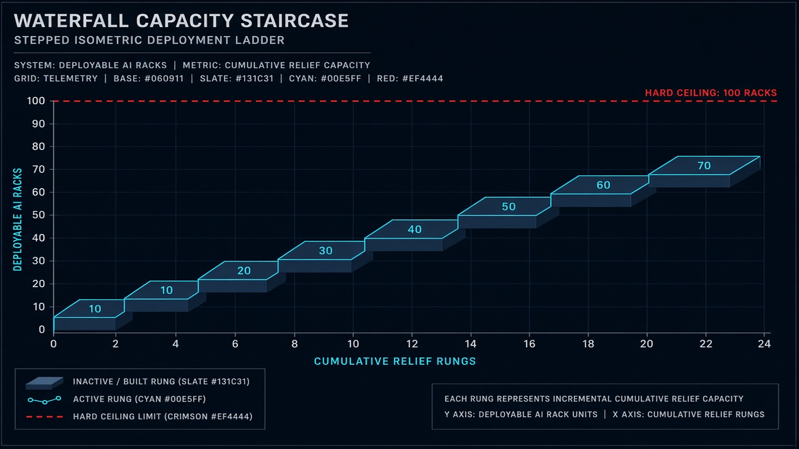

### 04. density-screen-four-stage-workflow
- **Routes**: `/services`, `/density-screen`
- **Alt**: Four-stage workflow pipeline: operator intake of drawings, GridForge deterministic solve, senior engineer review, and decision deliverable cards.
- **Preview**: 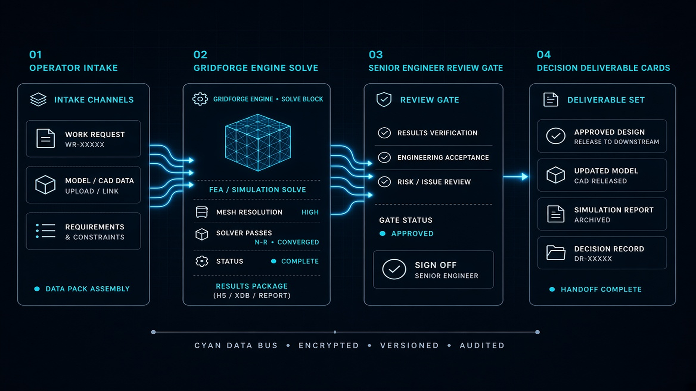

### 05. capacity-envelope-racks-vs-kw-curve
- **Routes**: `/envelope-study`, `/methodology#envelope`
- **Alt**: Engineering plot of max deployable racks versus power per rack with five constraint curves and feasible operating envelope shaded.
- **Preview**: 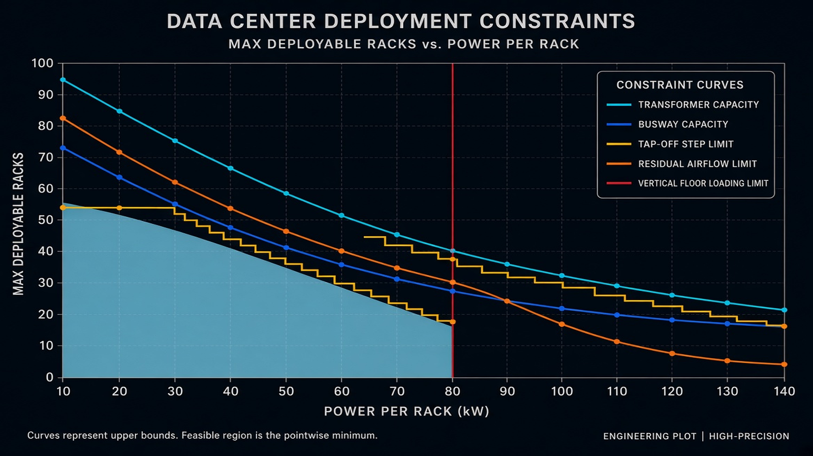

### 06. electrical-chain-grid-to-rack-ampacity
- **Routes**: `/product#electrical`, `docs/electrical-model.md`
- **Alt**: Isometric electrical chain from 11/33 kV utility intake through transformer, UPS, busway to 63 A tap-off with nameplate versus usable capacity bars.
- **Preview**: 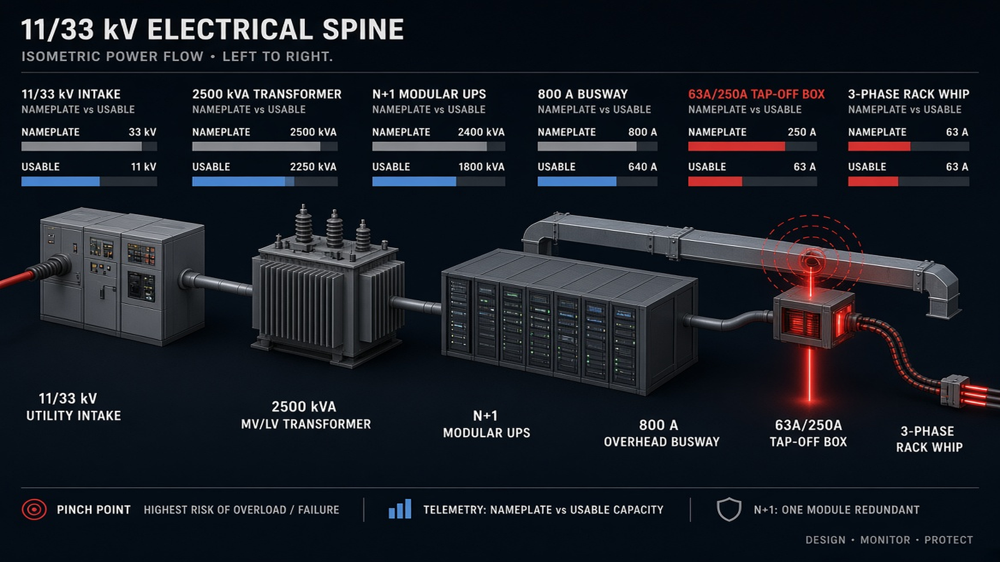

### 07. liquid-cooling-residual-air-trap
- **Routes**: `/platforms`, `#thermal-trap`
- **Alt**: Isometric cutaway of 132 kW liquid-cooled rack showing 80-82% cyan liquid to CDU and 18-20% residual air heat overwhelming legacy CRAHs.
- **Preview**: 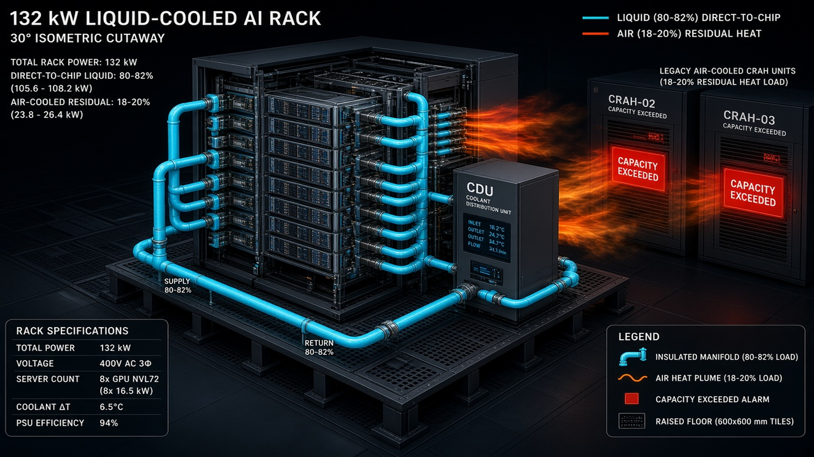

### 08. platform-benchmark-gb200-vs-50kw-rack
- **Routes**: `/platforms`
- **Alt**: Side-by-side schematic of NVIDIA GB200 NVL72 liquid rack versus generic 50 kW air/rear-door rack with mass and power telemetry.
- **Preview**: 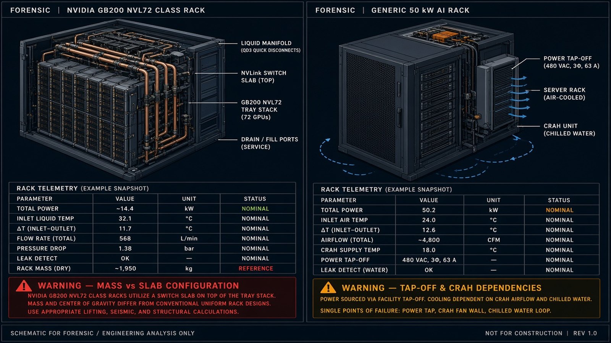

### 09. free-qualifier-seven-inputs-ui
- **Routes**: `/check`, `/qualifier`
- **Alt**: Dark product UI showing seven hall input fields feeding GridForge solver and instant binding constraint output card.
- **Preview**: 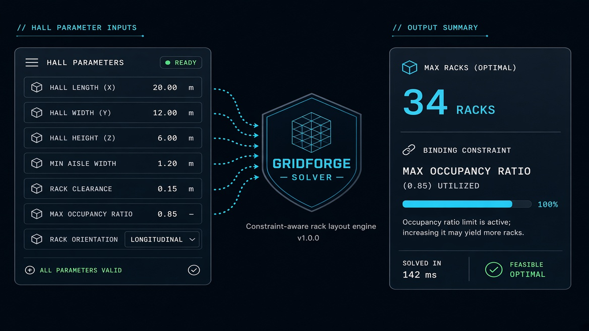

### 10. evidence-grading-scale-e0-to-e7
- **Routes**: `/evidence`, `/methodology#evidence-classes`
- **Alt**: Eight-tier evidence ladder from E0 default heuristic to E7 continuous telemetry, with pilot-stage calibration ledger note of zero field rows.
- **Preview**: 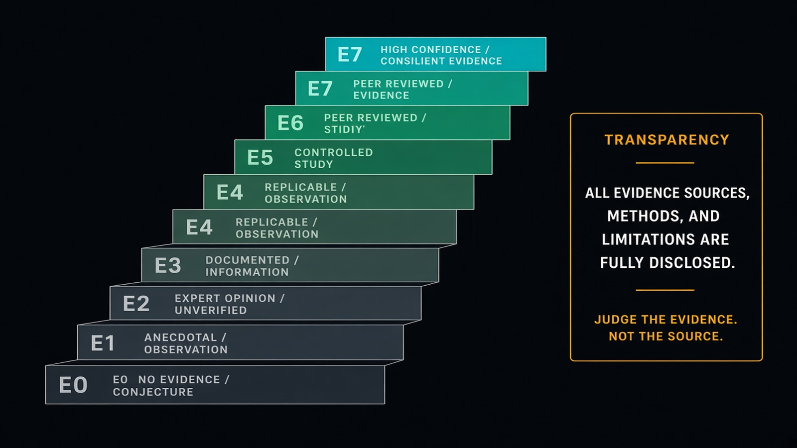

### 11. commercial-model-three-paths
- **Routes**: `/pricing`
- **Alt**: Three vertical cards for free capacity check, metered engine API, and fixed-fee density screen engagements.
- **Preview**: 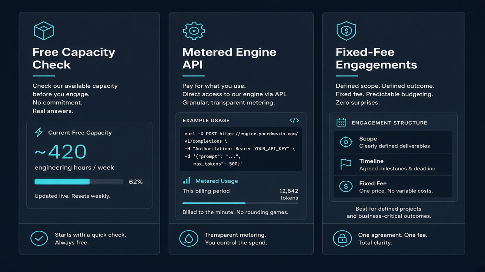

### 12. critical-path-time-to-power-gantt
- **Routes**: `/why-existing-halls`, `#time-to-power`
- **Alt**: Dual timeline comparing 36-60 month greenfield substation queue against weeks-scale GridForge brownfield headroom path to energized racks.
- **Preview**: 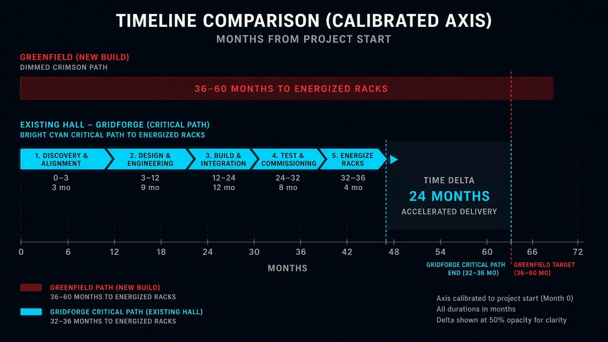

### 13. synthetic-hall-worked-floorplan
- **Routes**: `/example`
- **Alt**: Isometric floorplan of synthetic 2.0 MW hall with three aisles: cyan active 120 kW, amber 36 kW capped, and dark stranded wireframes.
- **Preview**: 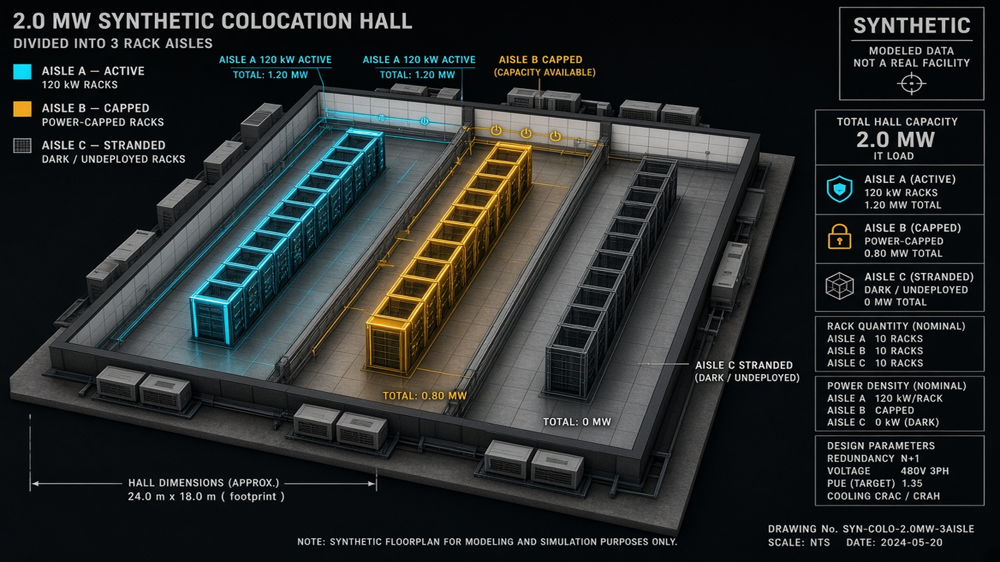

### 14. portfolio-multi-hall-triage-matrix
- **Routes**: `/portfolio`, `/investors`
- **Alt**: Executive dashboard of six synthetic halls ranked by unlockable headroom, lead time and evidence class, highlighting fastest ROI and deferred transformer-bound halls.
- **Preview**: 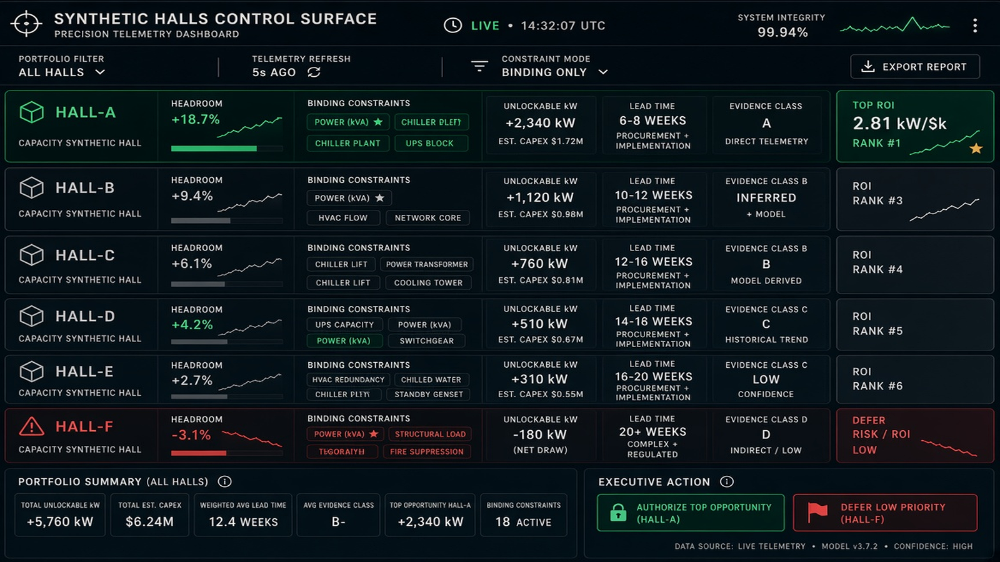

### 15. gridforge-deterministic-api-architecture
- **Routes**: `/developers`, `/api`, `README.md` architecture
- **Alt**: Layered architecture diagram from client JSON payload through schema validation, three parallel solvers, ranker and provenance tagger to REST outputs.
- **Preview**: 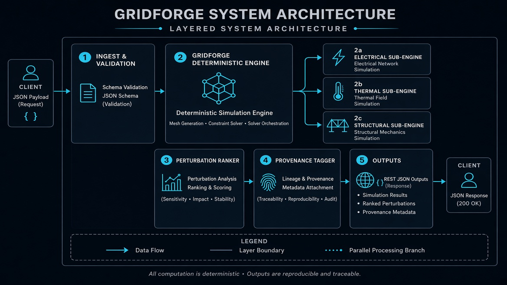

Manifest: `public/images/visuals/visual-manifest.json` contains full schema.org ImageObject blocks, alt text, AEO summaries and keywords for each asset.
